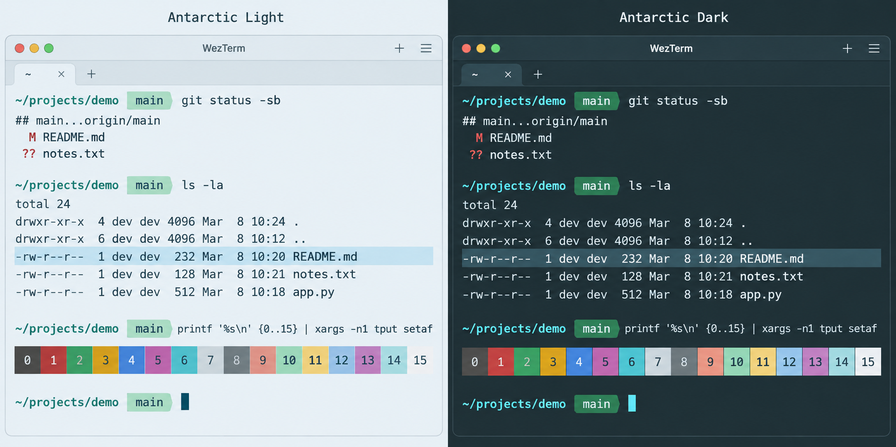

# Antarctic for WezTerm

Light and dark themes based on the shared [Antarctic palette](https://github.com/AntarcticTheme/.github/blob/main/profile/README.md).



## Requirements

Install [WezTerm](https://wezterm.org/installation.html). No separate theme plugin is required.

## Install

Make sure you have the folder `"$HOME/.config/wezterm/colors"` already created.

```sh
curl -fL https://raw.githubusercontent.com/AntarcticTheme/WezTerm/main/colors/Antarctic-Light.toml -o "$HOME/.config/wezterm/colors/Antarctic-Light.toml"
curl -fL https://raw.githubusercontent.com/AntarcticTheme/WezTerm/main/colors/Antarctic-Dark.toml -o "$HOME/.config/wezterm/colors/Antarctic-Dark.toml"
```

Edit `~/.wezterm.lua` or `~/.config/wezterm/wezterm.lua`, before its existing `return config`:

```lua
config.color_scheme = "Antarctic Dark"
```

For a new config file, use:

```lua
local wezterm = require("wezterm")
local config = wezterm.config_builder()
config.color_scheme = "Antarctic Dark"
return config
```

Set `Antarctic Light` for light mode. WezTerm discovers custom schemes in `~/.config/wezterm/colors` automatically. For another directory, set `config.color_scheme_dirs = { "/full/path/to/colors" }`.

On Windows, download both TOML files through GitHub, create a writable folder such as `%USERPROFILE%\.config\wezterm\colors`, then set `config.color_scheme_dirs = { wezterm.home_dir .. "/.config/wezterm/colors" }` in your config.

Includes ANSI colors, foreground, background, cursor, and selection.

## Updates

To update, repeat the download/copy steps, then restart the application or reload its configuration.

Released under the MIT license. See [LICENSE](LICENSE).
